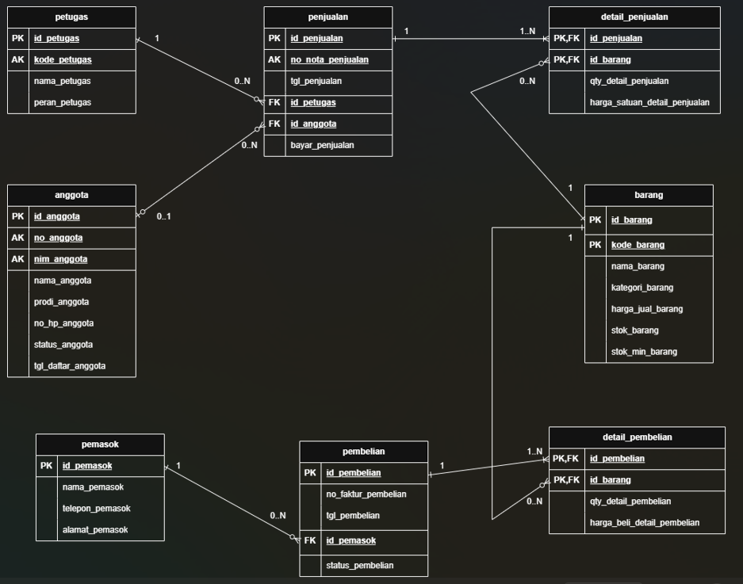
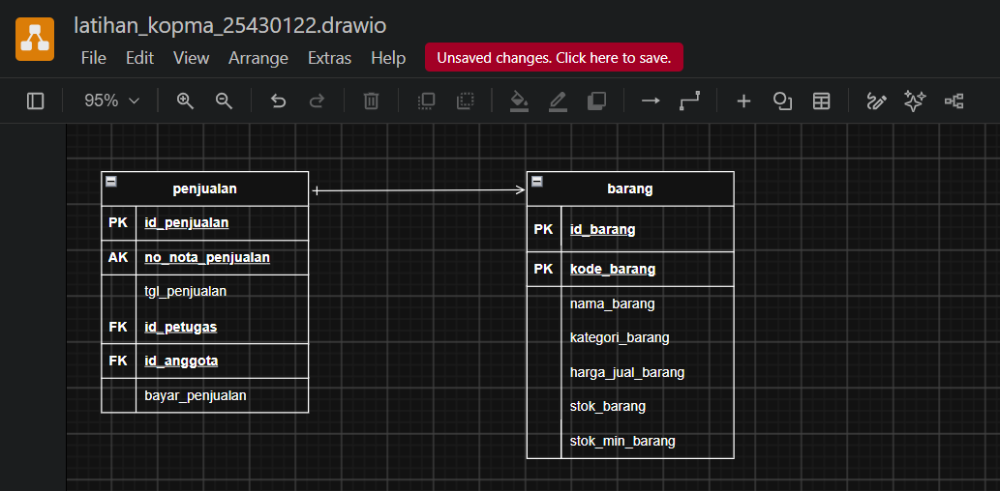
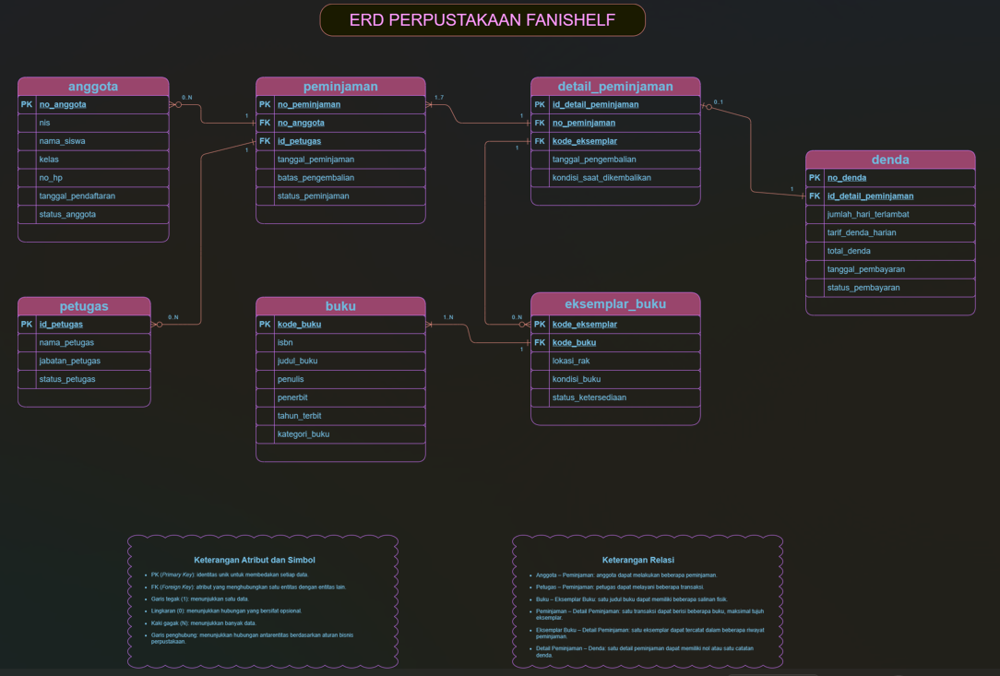

# Laporan Praktikum Basis Data - Pertemuan 2
**Nama:** Fanisa Anggraini
**NIM:** 25430122
**Kelas:** C
**Tanggal:** 14/10/2026
**Dosen:** Dedi Irawan, S.Kom., M.T.I.

## 1. Tujuan Praktikum

Praktikum ini bertujuan untuk memahami cara membuat ERD berdasarkan kebutuhan data. Selain itu, praktikum ini melatih saya menentukan entitas, atribut, kunci, hubungan, dan kardinalitas dengan benar. Saya juga belajar menggunakan entitas asosiatif serta memeriksa apakah ERD sudah sesuai dengan kebutuhan informasi.

## 2. Ringkasan Dasar Teori

Entity-Relationship Diagram (ERD) adalah diagram yang digunakan untuk menggambarkan data dan hubungan antarentitas dalam sebuah basis data. ERD membantu kita memahami data apa saja yang diperlukan dan bagaimana data tersebut saling berhubungan.
Dalam ERD, entitas merupakan hal yang datanya disimpan, misalnya anggota, buku, dan peminjaman. Atribut adalah informasi yang dimiliki entitas, sedangkan kunci digunakan untuk membedakan data dan menghubungkan satu entitas dengan entitas lainnya. Relasi menunjukkan hubungan antarentitas, sementara kardinalitas menjelaskan jumlah hubungan yang dapat terjadi.
Relasi banyak-ke-banyak dapat dipecah menggunakan entitas asosiatif yang memiliki atribut sendiri, seperti detail_peminjaman pada Perpustakaan FaniShelf. ERD biasanya digambarkan menggunakan notasi Crow's Foot untuk menunjukkan kardinalitas dan partisipasi. Setelah selesai dibuat, ERD perlu diperiksa kembali agar hubungan antarentitas sesuai dengan aturan bisnis dan dapat memenuhi kebutuhan informasi yang telah ditentukan.

## 3. Hasil Langkah Percobaan

### 3.1 Hasil Identifikasi Entitas dan Kunci

Pada tahap ini, saya mengidentifikasi entitas dan kunci yang digunakan dalam basis data Kopma. Terdapat delapan entitas, yaitu `petugas`, `anggota`, `barang`, `pemasok`, `penjualan`, `detail_penjualan`, `pembelian`, dan `detail_pembelian`.

Setiap entitas memiliki atribut sesuai fungsinya. Kunci primer (PK) digunakan sebagai identitas utama data, kunci alternatif (AK) digunakan untuk menunjukkan atribut unik lainnya, sedangkan kunci tamu (FK) digunakan untuk menghubungkan data antarentitas. Entitas `detail_penjualan` dan `detail_pembelian` digunakan untuk mencatat rincian barang dalam setiap transaksi.

### 3.2 Hasil Penentuan Relasi dan Kardinalitas

Hubungan antarentitas ditentukan berdasarkan proses bisnis dan aturan bisnis Kopma. Setiap hubungan diperiksa dari sisi jumlah minimum dan maksimum agar kardinalitasnya sesuai dengan kebutuhan.

| No. | Relasi | Kardinalitas | Dasar |
|---|---|---|---|
| 1 | Petugas melayani penjualan | Satu petugas dapat melayani `0..N` penjualan. Setiap penjualan dilayani tepat `1` petugas. | Wawancara kasir |
| 2 | Anggota melakukan penjualan | Satu anggota dapat memiliki `0..N` penjualan. Setiap penjualan terkait `0..1` anggota. | AB-02 |
| 3 | Penjualan memiliki detail penjualan | Satu penjualan memiliki `1..N` detail. Setiap detail berasal dari tepat `1` penjualan. | AB-01 |
| 4 | Barang tercantum pada detail penjualan | Satu barang dapat tercatat pada `0..N` detail. Setiap detail mengacu pada tepat `1` barang. | AB-04 |
| 5 | Pemasok menerima pesanan pembelian | Satu pemasok dapat memiliki `0..N` pembelian. Setiap pembelian mengacu pada tepat `1` pemasok. | AB-06 |
| 6 | Pembelian memiliki detail pembelian | Satu pembelian memiliki `1..N` detail. Setiap detail berasal dari tepat `1` pembelian. | Faktur pemasok |
| 7 | Barang tercantum pada detail pembelian | Satu barang dapat tercatat pada `0..N` detail pembelian. Setiap detail pembelian mengacu pada tepat `1` barang. | Data barang dan faktur pemasok |

Kardinalitas tersebut menunjukkan bahwa satu transaksi dapat melibatkan beberapa rincian barang. Karena itu, `detail_penjualan` dan `detail_pembelian` diperlukan untuk mencatat setiap barang yang terlibat dalam transaksi.

### 3.3 Hasil Penggambaran ERD Kopma

ERD Kopma dibuat menggunakan draw.io dengan menggambarkan delapan entitas beserta atribut, kunci primer, kunci alternatif, kunci tamu, dan hubungan antardata. Diagram ini membantu memperjelas hubungan antara petugas, anggota, barang, pemasok, serta transaksi penjualan dan pembelian.

Berkas sumber diagram: `p03_erd_kopma_25430122.drawio`

Berkas gambar diagram: `p03_erd_kopma_25430122.png`

### 3.4 Hasil Validasi ERD terhadap Kebutuhan Informasi

Validasi dilakukan dengan menelusuri hubungan antarentitas untuk memastikan ERD Kopma dapat digunakan sebagai dasar dalam memenuhi kebutuhan informasi yang telah disusun pada Modul 2.

| Kode KI | Kebutuhan Informasi | Jalur ERD |
|---|---|---|
| KI-01 | Omzet dan jumlah nota per hari dan per bulan | `penjualan` → `detail_penjualan` |
| KI-02 | Lima barang terlaris per bulan berdasarkan jumlah terjual | `barang` → `detail_penjualan` |
| KI-03 | Barang dengan stok di bawah batas minimum | `barang` |
| KI-04 | Sepuluh anggota dengan belanja terbesar per bulan | `anggota` → `penjualan` → `detail_penjualan` |

Berdasarkan hasil penelusuran, setiap kebutuhan informasi dapat dikaitkan dengan entitas yang sesuai pada ERD.

## 4. Jawaban Titik Analisis

**Analisis 1**
- Walaupun no_anggota dan nim_anggota sama-sama unik, buku tetap menggunakan id_anggota sebagai primary key karena lebih mudah digunakan sebagai identitas utama anggota. NIM bisa saja berubah jika ada perubahan data atau aturan kampus. Jika NIM dijadikan primary key, perubahan tersebut bisa membuat data di tabel lain yang menggunakan NIM ikut bermasalah. Karena itu, id_anggota digunakan sebagai identitas utama, sedangkan NIM tetap bisa digunakan untuk mengenali anggota.

**Analisis 2**
- Setiap penjualan harus memiliki minimal satu detail_penjualan karena transaksi harus mencatat barang yang dibeli. Kalau tidak ada detailnya, kita tidak tahu barang apa yang dijual dalam transaksi tersebut. Aturan ini berkaitan dengan AB-01.

Aturan minimal satu detail belum bisa dijaga hanya dengan struktur tabel biasa. Kunci tamu (FK) bisa memastikan detail penjualan terhubung dengan transaksi yang ada, tetapi belum bisa memastikan setiap transaksi memiliki detail. Karena itu, diperlukan proses tambahan untuk memastikan transaksi tidak diselesaikan sebelum memiliki minimal satu detail.

**Analisis 3**
- ERD Kopma saat ini belum bisa menunjukkan petugas gudang yang menerima barang dari pemasok karena belum ada hubungan yang mencatat petugas penerima pada proses pembelian. Untuk mengatasinya, perlu ditambahkan hubungan antara petugas dan pembelian, misalnya dengan menambahkan atribut id_petugas_penerima sebagai FK pada entitas pembelian.

Keputusan ini juga perlu dicatat sebagai aturan bisnis baru jika Kopma memang ingin mencatat siapa petugas yang menerima barang. Dengan begitu, data penerimaan barang bisa dilacak dengan lebih mudah.

## 5. Hasil Latihan dan Modifikasi

- Menurut saya, jika Kopma hanya ingin mengetahui jumlah poin yang dimiliki setiap anggota saat ini, poin bisa ditambahkan sebagai atribut poin_anggota pada entitas anggota. Namun, jika Kopma ingin mencatat riwayat penambahan dan penggunaan poin, sebaiknya dibuat entitas baru bernama riwayat_poin.Entitas riwayat_poin berguna untuk mencatat kapan poin bertambah atau berkurang dan berapa jumlahnya. Dengan begitu, perubahan poin anggota dapat diketahui dengan lebih mudah.

- Jika hubungan penjualan dan barang dibuat secara langsung, data detail transaksi akan sulit dicatat. Data seperti jumlah barang yang dibeli (qty_detail_penjualan) dan harga satuan saat transaksi (harga_satuan_detail_penjualan) tidak memiliki tempat penyimpanan yang tepat.Karena itu, diperlukan entitas asosiatif detail_penjualan untuk menyimpan kedua data tersebut. Dengan adanya entitas ini, setiap barang yang dibeli dalam transaksi dapat dicatat dengan jelas.

## 6. Tugas Mandiri: Milestone Proyek 2

### 6.1 ERD Perpustakaan FaniShelf

ERD Perpustakaan FaniShelf dibuat berdasarkan dokumen kebutuhan data pada Modul 2. Diagram ini menggambarkan entitas, atribut, kunci, dan hubungan yang diperlukan untuk mendukung proses pengelolaan perpustakaan. 

Berkas sumber diagram: `p03_erd_25430122.drawio`

### 6.2 Tabel Relasi dan Kardinalitas

Tabel ini menjelaskan hubungan antarentitas pada Perpustakaan FaniShelf. Kardinalitas ditentukan berdasarkan aturan bisnis yang telah disusun pada Modul 2.

| No. | Relasi | Kardinalitas | Dasar Aturan Bisnis | Alasan |
|---|---|---|---|---|
| 1 | Anggota melakukan peminjaman | Anggota `0..N`, peminjaman `1` | AB-03, AB-04 | Anggota dapat belum pernah meminjam atau memiliki beberapa transaksi. Setiap transaksi mencatat anggota yang meminjam. |
| 2 | Petugas melayani peminjaman | Petugas `0..N`, peminjaman `1` | AB-04 | Petugas dapat melayani banyak transaksi, sedangkan setiap transaksi mencatat petugas yang melayani. |
| 3 | Buku memiliki eksemplar | Buku `0..N`, eksemplar buku `1` | AB-11 | Satu judul dapat memiliki beberapa eksemplar. Setiap eksemplar harus terhubung dengan satu judul buku. |
| 4 | Peminjaman memiliki detail peminjaman | Peminjaman `1..7`, detail peminjaman `1` | AB-05 | Satu transaksi berisi minimal satu dan maksimal tujuh eksemplar yang dipinjam. |
| 5 | Eksemplar buku tercatat dalam detail peminjaman | Eksemplar buku `0..N`, detail peminjaman `1` | AB-06, AB-11 | Satu eksemplar dapat memiliki banyak catatan peminjaman sepanjang riwayatnya. Setiap detail mengacu pada satu eksemplar. |
| 6 | Detail peminjaman memiliki catatan denda | Detail peminjaman `0..N`, denda `1` | AB-08, AB-09, AB-10 | Satu detail dapat tidak memiliki denda atau memiliki catatan denda. Setiap catatan denda mengacu pada satu detail peminjaman. |

Keterangan: `0..N` berarti boleh tidak ada atau dapat berjumlah banyak, `1` berarti tepat satu, dan `1..7` berarti minimal satu sampai maksimal tujuh.

### 6.3 Tabel Penelusuran KI ke Jalur ERD

Penelusuran kebutuhan informasi dilakukan untuk memastikan setiap kebutuhan informasi dapat dijawab melalui entitas dan hubungan yang terdapat pada ERD Perpustakaan FaniShelf.

| Kode KI | Kebutuhan Informasi | Jalur ERD |
|---|---|---|
| KI-01 | Daftar anggota aktif berdasarkan kelas | `anggota` |
| KI-02 | Ketersediaan buku berdasarkan judul atau kategori | `buku` → `eksemplar_buku` |
| KI-03 | Peminjaman yang masih berlangsung beserta batas pengembalian | `anggota` → `peminjaman` → `detail_peminjaman` → `eksemplar_buku` → `buku` |
| KI-04 | Anggota yang terlambat mengembalikan buku dan jumlah dendanya | `anggota` → `peminjaman` → `detail_peminjaman` → `denda`, serta `detail_peminjaman` → `eksemplar_buku` → `buku` |
| KI-05 | Daftar denda yang sudah dan belum dibayar | `denda` → `detail_peminjaman` → `peminjaman` → `anggota` |
| KI-06 | Jumlah peminjaman setiap judul buku dalam periode tertentu | `buku` → `eksemplar_buku` → `detail_peminjaman` → `peminjaman` |
| KI-07 | Riwayat peminjaman dan pengembalian seorang anggota | `anggota` → `peminjaman` → `detail_peminjaman` → `eksemplar_buku` → `buku` |

Berdasarkan penelusuran tersebut, ketujuh kebutuhan informasi memiliki jalur hubungan pada ERD. Jalur ini menjadi dasar untuk memeriksa apakah atribut dan relasi yang diperlukan sudah tersedia.

### 6.4 Entitas Asosiatif
Entitas detail_peminjaman digunakan untuk menghubungkan entitas peminjaman dengan eksemplar_buku. Entitas ini diperlukan karena satu transaksi peminjaman dapat mencakup beberapa eksemplar buku, sedangkan satu eksemplar dapat dipinjam kembali dalam transaksi yang berbeda pada waktu lain.

Selain menjadi penghubung, detail_peminjaman memiliki atribut sendiri, yaitu id_detail_peminjaman, no_peminjaman, kode_eksemplar, tanggal_pengembalian, dan kondisi_saat_dikembalikan.

Dengan adanya entitas ini, setiap eksemplar yang dipinjam dapat ditelusuri berdasarkan transaksi, tanggal pengembalian, dan kondisinya saat dikembalikan.

### 6.5 Tinjauan Klien (Client Review)

Tinjauan klien dilakukan dengan meminta teman untuk memeriksa ERD Perpustakaan FaniShelf dan memberikan saran. Masukan yang diberikan kemudian dipertimbangkan berdasarkan kebutuhan sistem.

| No. | Bagian yang Ditinjau | Masukan Teman | Keputusan | Alasan |
|---|---|---|---|---|
| 1 | `detail_peminjaman` dan `denda` | Menambahkan atribut `created_at` dan `updated_at` untuk mencatat waktu pembuatan dan perubahan data. Atribut ini dapat membantu melacak riwayat data peminjaman dan denda. | Ditolak untuk rancangan saat ini | Rancangan sudah memiliki atribut tanggal khusus, seperti `tanggal_pengembalian` dan `tanggal_pembayaran`. Atribut tambahan untuk melacak perubahan data belum menjadi kebutuhan utama dalam rancangan saat ini. |
| 2 | `anggota` dan `petugas` | Menambahkan atribut `email` dan `password` jika perpustakaan akan menyediakan fitur login online. | Ditolak untuk rancangan saat ini | Sistem yang dirancang saat ini berfokus pada pengelolaan data perpustakaan dan belum mencakup kebutuhan login online. Jika fitur tersebut dikembangkan, atribut akun dapat dipertimbangkan kembali. |

Berdasarkan tinjauan klien, kedua masukan telah dipertimbangkan sesuai dengan ruang lingkup sistem yang dirancang. Saran tersebut dapat digunakan sebagai bahan pengembangan apabila kebutuhan sistem berubah di kemudian hari.

## 7. Pembahasan dan Kendala

Pada praktikum Modul 3, ERD digunakan untuk menggambarkan entitas, atribut, dan hubungan antarentitas dalam sebuah basis data. Pengerjaan dimulai dari contoh Kopma, kemudian diterapkan pada proyek Perpustakaan FaniShelf. Setiap hubungan ditentukan berdasarkan aturan bisnis agar kardinalitasnya sesuai dengan kebutuhan sistem.
Kendala yang ditemui adalah memahami penempatan simbol kardinalitas pada setiap ujung garis relasi. Hal ini diatasi dengan memeriksa kembali arti setiap simbol dan memastikan bahwa simbol pada masing-masing ujung sesuai dengan jumlah hubungan yang mungkin terjadi. Selain itu, tinjauan klien membantu mempertimbangkan apakah masukan teman perlu diterapkan pada rancangan FaniShelf.
Melalui praktikum ini, saya lebih memahami bahwa ERD tidak hanya menggambarkan hubungan antartabel, tetapi juga harus sesuai dengan aturan bisnis dan kebutuhan informasi yang telah ditentukan.

## 8. Kesimpulan

Melalui praktikum Modul 3, saya belajar membuat ERD dengan menentukan entitas, atribut, kunci, dan hubungan antarentitas berdasarkan aturan bisnis. Saya juga memahami cara menentukan kardinalitas dan memeriksa apakah ERD sudah dapat memenuhi kebutuhan informasi. Dengan adanya ERD, rancangan basis data Kopma dan Perpustakaan FaniShelf menjadi lebih jelas dan mudah dipahami sebelum masuk ke tahap perancangan berikutnya.

## 9. Pernyataan Penggunaan AI

Saya menggunakan ChatGPT untuk membantu memahami materi ERD, menjelaskan kardinalitas, serta membantu menyusun dan merapikan bahasa dalam jawaban Titik Analisis, latihan, dan laporan proyek Perpustakaan FaniShelf. Hasil bantuan tersebut saya gunakan sebagai bahan belajar dan saya sesuaikan dengan pemahaman serta kebutuhan tugas. Pembuatan dan pengeditan diagram ERD dilakukan menggunakan draw.io.

## 10. Bukti Git 

* **Tautan Repositoi:** (https://github.com/fanisaanggraini/Basis-Data---25430122)
* **Hash Commit:** (9c19858 (HEAD -> main) p03: erd_kopma_dan laporan_25430122)

## Checklist 

- [x] Tujuan dan ringkasan teori.
- [x] Hasil percobaan ERD Kopma.
- [x] Jawaban Titik Analisis 1–3.
- [x] Latihan dan Modifikasi 1–2.
- [x] Tugas Mandiri ERD Perpustakaan FaniShelf.
- [x] Tabel relasi, kardinalitas, dan pemetaan KI.
- [x] Tinjauan klien beserta keputusan dan alasan.
- [x] Pembahasan, kesimpulan, dan pernyataan penggunaan AI.
- [x] Screenshot ERD dan bukti praktikum sudah lengkap.
- [x] File `.drawio` dan `.png` sudah tersimpan.
- [x] Laporan sudah di-commit dan di-push ke GitHub.
- [x] Hash commit sudah dicantumkan dalam laporan.
