# Laporan Praktikum Basis Data - Pertemuan 2
**Nama:** Fanisa Anggraini
**NIM:** 25430122
**Kelas:** C
**Tanggal:** 19/10/2026
**Dosen:** Dedi Irawan, S.Kom., M.T.I.

## 1. Tujuan Praktikum

1. Memahami anomali ubah, sisip, dan hapus pada data yang belum dinormalisasi.
2. Mengidentifikasi dependensi fungsional berdasarkan aturan bisnis.
3. Melakukan normalisasi data hingga 3NF serta memeriksa BCNF.
4. Menentukan penyimpanan nilai turunan dan menyusun skema relasional akhir.

## 2. Ringkasan Dasar Teori

Normalisasi merupakan proses penyusunan data ke dalam beberapa relasi agar penyimpanan data lebih teratur dan mengurangi kemungkinan terjadinya anomali. Anomali dapat berupa anomali ubah, sisip, dan hapus yang terjadi akibat penyimpanan data yang berulang.
Dalam proses normalisasi, digunakan dependensi fungsional untuk mengetahui hubungan antara atribut yang satu dengan atribut lainnya. Dependensi fungsional ditulis menggunakan tanda panah (→), yang menunjukkan bahwa suatu atribut menentukan nilai atribut lainnya.
Normalisasi dilakukan melalui beberapa tahapan. Bentuk 1NF mengharuskan setiap kolom memiliki nilai atomik dan tidak terdapat grup berulang. Bentuk 2NF menghilangkan ketergantungan parsial pada kunci gabungan. Bentuk 3NF menghilangkan ketergantungan transitif pada atribut nonkunci. Selain itu, BCNF digunakan untuk memastikan setiap determinan merupakan kunci kandidat.
Melalui normalisasi, rancangan basis data diharapkan memiliki struktur yang lebih teratur, mengurangi pengulangan data, dan menjaga konsistensi informasi.

## 3. Hasil Langkah Percobaan

### 3.1 Normalisasi dari UNF ke 1NF (D.1)

Pada tahap ini dilakukan normalisasi terhadap data nota penjualan Kopma. Bentuk UNF masih memiliki grup berulang karena satu nota dapat mencatat beberapa barang dalam satu transaksi.
Selanjutnya, data diubah ke bentuk 1NF dengan menghilangkan grup berulang dan membuat satu baris untuk setiap barang dalam setiap nota. Kunci primer yang digunakan adalah gabungan nomor nota penjualan dan kode barang.
Dengan perubahan tersebut, setiap baris hanya mencatat satu barang pada satu transaksi sehingga data memenuhi bentuk 1NF. 

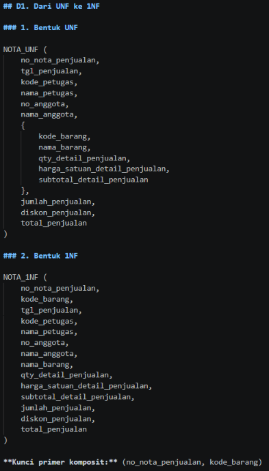

### 3.2 Menuliskan Dependensi Fungsional (D.2)

Pada tahap ini dilakukan identifikasi dependensi fungsional berdasarkan aturan bisnis pada data penjualan Kopma. Dependensi fungsional digunakan untuk mengetahui atribut yang menentukan nilai atribut lainnya.
Hasil identifikasi menunjukkan enam dependensi fungsional, mulai dari hubungan nomor nota dengan informasi transaksi hingga perhitungan subtotal pada detail penjualan.

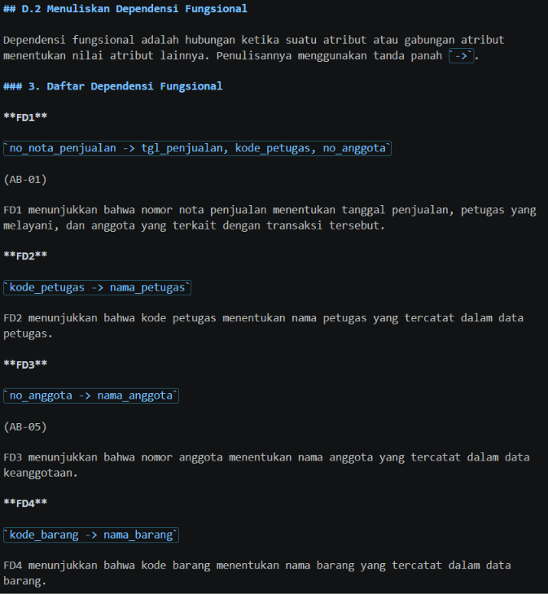 
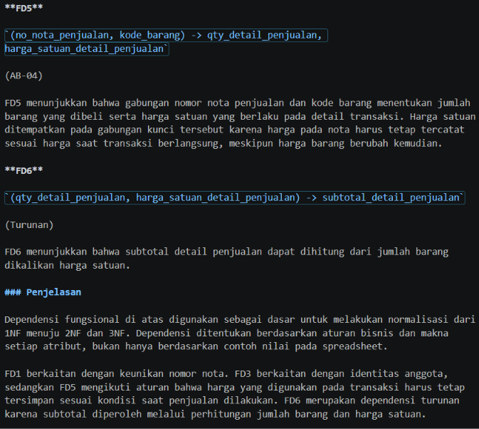 

### 3.3 Menuju 2NF dan 3NF (D.3)

Pada tahap ini, data penjualan Kopma dinormalisasi menjadi bentuk 2NF dan 3NF. Pada tahap 2NF, atribut yang bergantung pada sebagian kunci primer komposit dipisahkan ke dalam relasi penjualan, barang, dan detail penjualan.
Selanjutnya, pada tahap 3NF, informasi petugas dan anggota dipisahkan dari relasi penjualan karena terdapat ketergantungan transitif. Pemisahan ini dilakukan agar nama petugas dan nama anggota tidak perlu disimpan berulang pada setiap transaksi.
Selain itu, dilakukan penentuan nilai turunan. Nilai subtotal detail penjualan, jumlah penjualan, dan total penjualan diputuskan untuk tidak disimpan sebagai kolom tersendiri karena dapat dihitung dari data transaksi. Sementara itu, informasi pembayaran tetap dicatat.

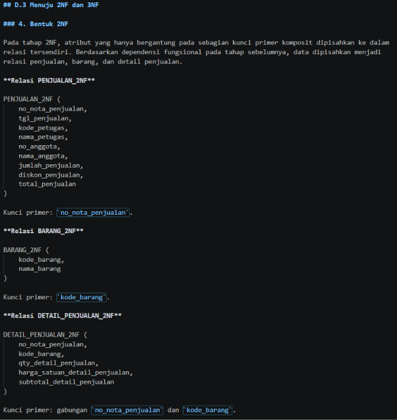 
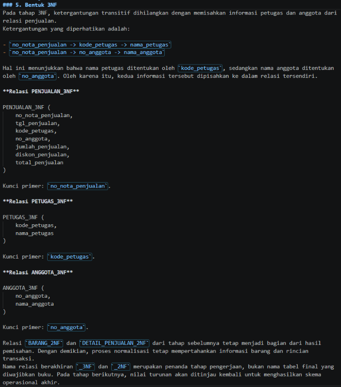 
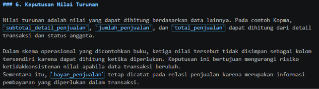 

### 3.4 Mencocokkan dengan Skema Kanonik Kopma (D.4)

Pada tahap ini, hasil normalisasi dibandingkan dengan skema kanonik Kopma yang terdapat pada Tabel 4.2 buku praktikum. Perbandingan dilakukan untuk melihat kesesuaian struktur tabel, penggunaan kunci primer, kunci unik, dan kunci tamu.
Skema kanonik menggunakan kunci pengganti (surrogate key) sebagai kunci primer, sedangkan kode atau nomor alami tetap dipertahankan sebagai kunci unik.
Selanjutnya, dilakukan pemeriksaan BCNF pada setiap tabel untuk memastikan bahwa setiap determinan merupakan kunci kandidat berdasarkan dependensi fungsional yang telah diidentifikasi.

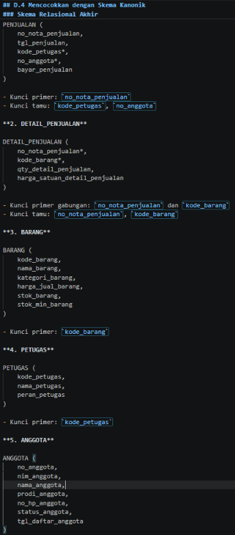 
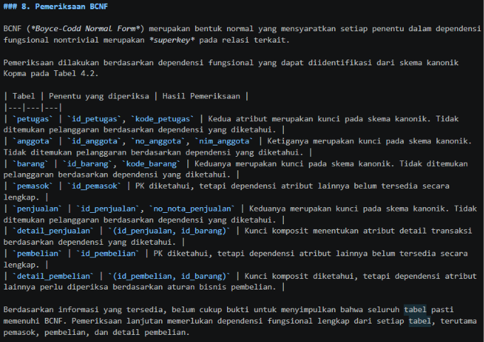 

## 4. Jawaban Titik Analisis

**Analisis 1**

Karena harga barang dalam setiap transaksi penjualan dapat berbeda, meskipun barang yang dijual memiliki kode yang sama. Harga pada suatu transaksi ditentukan berdasarkan barang dan nomor nota penjualan, sehingga dependensinya menggunakan gabungan kedua atribut tersebut.
Apabila harga_satuan_detail_penjualan dipindahkan ke tabel barang, harga transaksi lama dapat berubah mengikuti harga barang saat ini. Akibatnya, perhitungan omzet tahun lalu menjadi tidak akurat karena tidak lagi menggunakan harga yang sebenarnya berlaku ketika transaksi dilakukan.

**Analisis 2**

Keputusan tersebut tetap konsisten karena data operasional dan data historis memiliki kebutuhan yang berbeda. Pada data operasional, total penjualan dapat dihitung kembali dari detail transaksi sehingga tidak perlu disimpan sebagai kolom tersendiri. Hal ini dapat mengurangi risiko ketidakkonsistenan apabila data transaksi berubah.
Sementara itu, pada data arsip penjualan, total disimpan sebagai catatan historis yang menggambarkan kondisi transaksi pada saat terjadi. Nilai tersebut perlu dipertahankan agar riwayat transaksi tidak berubah meskipun terdapat perubahan data operasional.

**Analisis 3**

Informasi mengenai pemasok disimpan melalui tabel PEMBELIAN dan DETAIL_PEMBELIAN. Tabel PEMBELIAN menghubungkan transaksi pembelian dengan pemasok melalui id_pemasok, sedangkan DETAIL_PEMBELIAN mencatat barang yang dibeli dalam transaksi tersebut.
Pemisahan ini lebih baik karena satu barang dapat diperoleh dari beberapa pemasok dan satu pemasok dapat menyediakan berbagai jenis barang. Selain itu, informasi pemasok dapat ditelusuri berdasarkan transaksi pembelian tanpa harus menyimpan satu nama pemasok secara tetap di tabel barang.

## 5. Hasil Latihan dan Modifikasi

### 5.1 Latihan E.1 — Beberapa Nomor Telepon Pemasok

Pada latihan ini, Kopma membutuhkan pencatatan beberapa nomor telepon untuk setiap pemasok. Apabila beberapa nomor telepon disimpan dalam satu kolom, data menjadi tidak atomik dan dapat menimbulkan masalah dalam pengelolaan data.

Oleh karena itu, data nomor telepon dipisahkan ke dalam relasi tersendiri. Relasi yang digunakan adalah:

**PEMASOK**

(
    id_pemasok
)

PK: id_pemasok

**TELEPON_PEMASOK**

(
    id_pemasok,
    no_telepon
)

PK: (id_pemasok, no_telepon)
FK: id_pemasok 

Pemisahan ini memungkinkan satu pemasok memiliki beberapa nomor telepon tanpa menyimpan banyak nomor dalam satu kolom. Dengan demikian, data nomor telepon menjadi lebih teratur dan memenuhi prinsip 1NF.

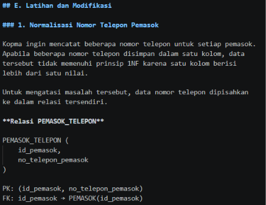 

### 5.1 Latihan E.1.2. Contoh Anomali Ubah pada Tabel Penjualan

Apabila nama_anggota disimpan langsung pada tabel PENJUALAN, 
informasi nama anggota akan berulang setiap kali anggota 
melakukan transaksi penjualan.

Contoh data:

| no_nota_penjualan | no_anggota | nama_anggota |
|---|---|---|
| PJ-001 | AG-001 | Andi |
| PJ-002 | AG-001 | Andi |

Misalnya, nama anggota Andi berubah menjadi Andika. 
Perubahan hanya dilakukan pada salah satu transaksi 
menggunakan kueri berikut:

UPDATE PENJUALAN
SET nama_anggota = 'Andika'
WHERE no_nota_penjualan = 'PJ-001';

Setelah perubahan, data menjadi:

| no_nota_penjualan | no_anggota | nama_anggota |
|---|---|---|
| PJ-001 | AG-001 | Andika |
| PJ-002 | AG-001 | Andi |

Kondisi tersebut menunjukkan anomali ubah karena satu 
anggota memiliki dua nama berbeda pada transaksi yang 
berbeda, meskipun menggunakan nomor anggota yang sama.

Untuk menghindari masalah tersebut, nama anggota 
sebaiknya disimpan pada tabel ANGGOTA, sedangkan tabel 
PENJUALAN cukup menyimpan no_anggota sebagai kunci tamu.

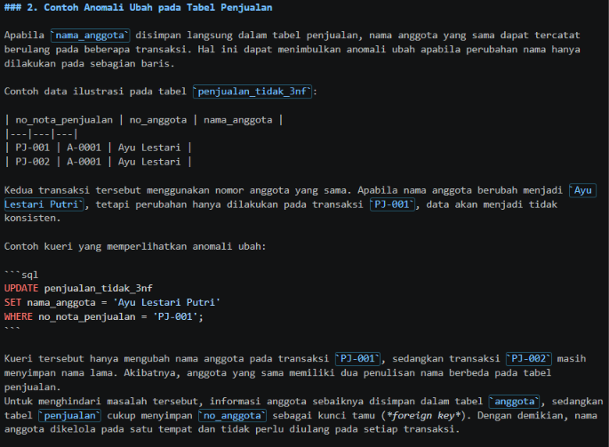 

### 5.2 Latihan E.2 — Anomali Ubah pada Tabel Penjualan

Pada latihan ini ditunjukkan bahwa penyimpanan nama anggota secara langsung pada tabel PENJUALAN dapat menimbulkan anomali ubah. Hal tersebut terjadi karena nama anggota yang sama dapat tercatat berulang pada beberapa transaksi.
Sebagai contoh, anggota dengan nomor AG-001 memiliki dua transaksi penjualan. Ketika nama anggota berubah, tetapi perubahan hanya dilakukan pada salah satu transaksi, data akan menjadi tidak konsisten.
Kueri UPDATE digunakan untuk memperlihatkan kondisi tersebut. Akibatnya, satu nomor anggota dapat memiliki dua nama berbeda pada tabel PENJUALAN.
Untuk menghindari anomali tersebut, nama anggota sebaiknya disimpan pada tabel ANGGOTA, sedangkan tabel PENJUALAN cukup menyimpan no_anggota sebagai kunci tamu.

 

## 6. Tugas Mandiri: Milestone Proyek 2

### 6.1 Normalisasi Proyek Perpustakaan FaniShelf

Pada tugas mandiri ini, dilakukan proses normalisasi pada basis data Perpustakaan FaniShelf dengan menggunakan Slip Peminjaman Buku sebagai dokumen sumber dari Modul 2.
Proses normalisasi dilakukan melalui tahapan UNF, 1NF, 2NF, dan 3NF. Setiap tahap digunakan untuk mengurangi pengulangan data serta menghilangkan ketergantungan yang tidak sesuai.
Selanjutnya, dilakukan identifikasi dependensi fungsional berdasarkan aturan bisnis FaniShelf, pemeriksaan BCNF, serta penentuan nilai turunan yang disimpan atau dihitung.
Hasil akhir normalisasi disesuaikan dengan rancangan ERD Modul 3 yang terdiri dari tujuh entitas, yaitu Anggota, Petugas, Buku, Eksemplar Buku, Peminjaman, Detail Peminjaman, dan Denda.

 
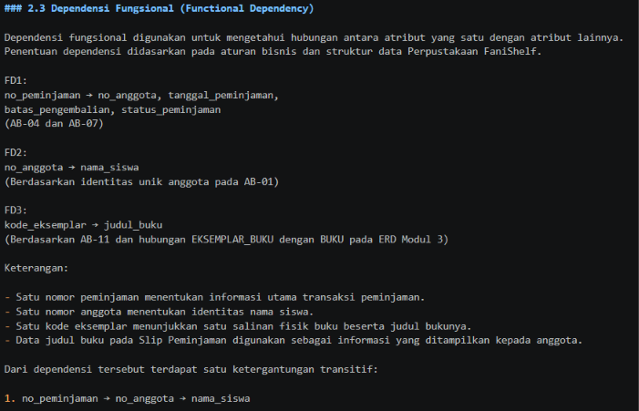 
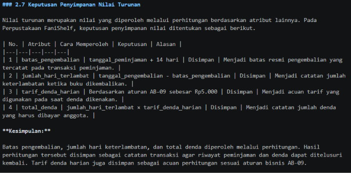  

## 7. Pembahasan dan Kendala

Pada praktikum Modul 4, dilakukan proses normalisasi data mulai dari bentuk UNF hingga 3NF. Proses ini membantu memahami pentingnya pemisahan data berdasarkan dependensi fungsional agar pengulangan data dan kemungkinan terjadinya anomali dapat dikurangi.
Dalam pengerjaan proyek Perpustakaan FaniShelf, normalisasi dilakukan menggunakan Slip Peminjaman Buku sebagai dokumen sumber. Hasilnya kemudian dicocokkan dengan rancangan ERD dari Modul 3 agar skema relasional akhir tetap sesuai dengan kebutuhan perpustakaan.
Kendala yang ditemui adalah memahami perbedaan antara hasil normalisasi dokumen sumber dengan skema relasional akhir proyek. Selain itu, diperlukan ketelitian dalam menentukan dependensi fungsional dan nilai turunan agar tidak terjadi ketidaksesuaian antarbagian.
Kendala tersebut diatasi dengan memeriksa kembali aturan bisnis, dokumen kebutuhan data, serta ERD yang telah dibuat pada pertemuan sebelumnya.

## 8. Kesimpulan

Melalui praktikum Modul 4, proses normalisasi membantu memahami cara mengurangi pengulangan data dan mencegah anomali pada basis data. Tahapan UNF hingga 3NF serta pemeriksaan BCNF memberikan pemahaman tentang pentingnya dependensi fungsional dalam menyusun relasi yang tepat. Penerapan normalisasi pada proyek Perpustakaan FaniShelf juga membantu menyusun struktur data yang lebih teratur dan sesuai dengan kebutuhan perpustakaan.

## 9. Pernyataan Penggunaan AI

Dalam pengerjaan praktikum Modul 4, saya menggunakan ChatGPT sebagai alat bantu untuk memahami materi normalisasi, mempelajari dependensi fungsional, serta membantu menyusun dan memeriksa penjelasan pada laporan dan tugas proyek.
Seluruh hasil bantuan AI diperiksa dan disesuaikan kembali dengan materi praktikum, dokumen kebutuhan data, serta ERD Perpustakaan FaniShelf yang telah dibuat. AI digunakan sebagai alat bantu pembelajaran, sedangkan pemahaman dan penyelesaian tugas tetap menjadi tanggung jawab saya.

## 10. Bukti Git

* **Tautan Repositoi:** (https://github.com/fanisaanggraini/Basis-Data---25430122)
* **Hash Commit:** (87faf9d (HEAD -> main, origin/main) p04: normalisasi perpustakaan)

## Checklist

# Checklist Praktikum Basis Data Modul 4

- [x] Praktik normalisasi Kopma (D).
- [x] Latihan E.1 dan E.2 selesai.
- [x] Normalisasi proyek FaniShelf (F).
- [x] Tahapan UNF, 1NF, 2NF, dan 3NF.
- [x] Dependensi fungsional dan pemeriksaan BCNF.
- [x] Keputusan penyimpanan nilai turunan.
- [x] Skema relasional akhir sesuai ERD.
- [x] Laporan Modul 4 selesai disusun.
- [x] Screenshot bukti D, E, dan F sudah disiapkan.
- [x] Screenshot sudah dipastikan tampil di laporan.
- [x] File normalisasi Kopma sudah di-commit dan di-push.
- [x] File normalisasi FaniShelf sudah di-commit dan di-push.
- [x] Hash commit P04 sudah dicatat dengan benar.
- [x] File laporan sudah di-commit dan di-push. 